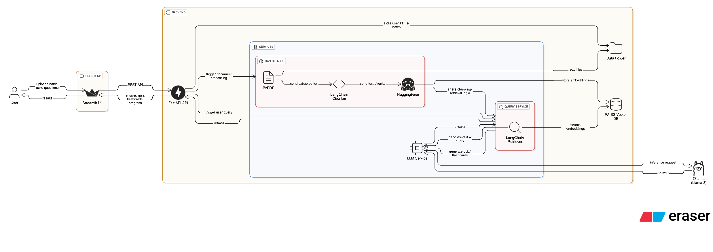

# Exam Prep Agent (work in progress)

An AI study companion that will answer questions from your own notes, generate quizzes and flashcards, and track progress. It is planned as a **retrieval-augmented generation (RAG)** app running fully locally: a **FastAPI** backend, a **Streamlit** frontend, **FAISS** for vector search, and **Ollama** for a local LLM, so your notes never leave your machine.

> **Status: Phase 1 of 4.** The backend and frontend skeleton work and talk to each other. The RAG pipeline (`backend/services/`) is scaffolded but not implemented yet.

## Architecture



```
Streamlit UI  ──HTTP──►  FastAPI backend
                          ├─ pdf_loader.py   PDF → text chunks
                          ├─ rag_service.py  embed chunks → FAISS index → retrieve top-k
                          └─ routes/qa.py    question + retrieved context → Ollama → answer
```

## Roadmap

- [x] **Phase 1:** FastAPI backend and Streamlit frontend with a connectivity check
- [ ] **Phase 2:** PDF upload, chunking, embeddings and a FAISS index (`pdf_loader.py`, `rag_service.py`)
- [ ] **Phase 3:** question answering grounded in your notes, with source citations, via Ollama (`routes/qa.py`)
- [ ] **Phase 4:** quiz and flashcard generation, plus progress tracking

## Run Phase 1

```bash
pip install -r requirements.txt
uvicorn backend.main:app --reload --port 8000     # terminal 1
streamlit run frontend/app.py                      # terminal 2 → click "Ping Backend"
```

## Project structure

```
backend/main.py                 FastAPI app (health route)
backend/routes/qa.py            Q&A endpoint            (Phase 3)
backend/services/pdf_loader.py  PDF parsing + chunking  (Phase 2)
backend/services/rag_service.py embeddings + FAISS      (Phase 2)
frontend/app.py                 Streamlit UI
architechture/                  architecture diagrams
```
